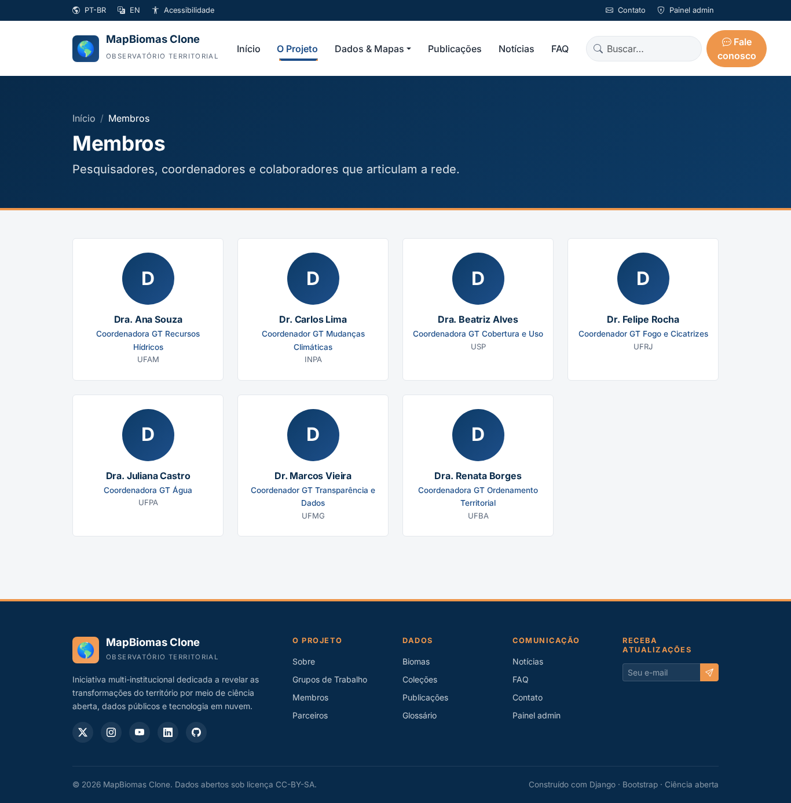

# Administração de membros

A página pública separa automaticamente **membros atuais** e
**histórico de participação**.

## Cadastrar uma pessoa

No Django Admin, abra **Membros** e informe nome, função, instituição, foto e,
quando conhecida, a data de início da participação.

Registros antigos podem permanecer sem data inicial até a informação ser confirmada.

## Encerrar uma participação

Preencha **Fim da participação** com a data real de encerramento.

A partir do dia seguinte à data informada, o registro deixa os cards de membros
atuais e passa para a tabela histórica.

!!! warning "Não desmarque “Publicado” para registrar uma saída"
    **Publicado** controla apenas a visibilidade pública. Se for desmarcado,
    a pessoa desaparece tanto da equipe atual quanto do histórico.

## Regras

- fim não pode ser anterior ao início;
- início futuro representa participação prevista;
- fim futuro mantém a pessoa como atual até a data definida;
- registros legados sem datas continuam atuais enquanto publicados.

## Captura de referência

*Imagem da versão anterior da página. O novo histórico deve ser conferido no ambiente local após a migração.*

Para que um antigo integrante apareça no histórico, preencha a data final e mantenha a
publicação habilitada. O sistema **não presume datas antigas** nem converte
automaticamente registros antes ocultos (`ativo=False`).
