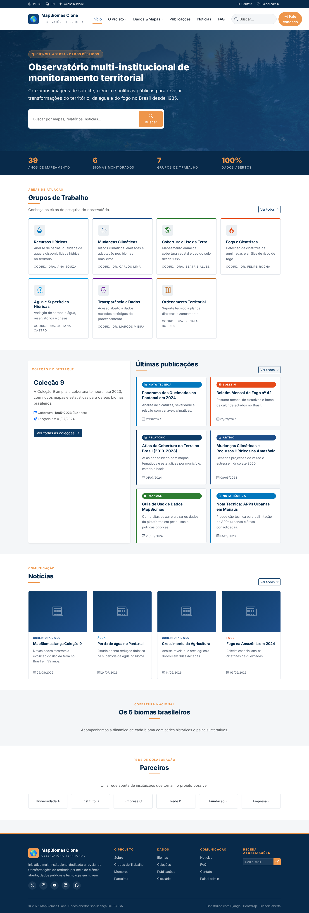

# Central de Ajuda do Observatório

Este manual reúne os procedimentos necessários para manter os conteúdos do
Observatório, administrar a equipe e publicar visualizações de dados.

## Para quem é este manual?

- equipe responsável pelo painel administrativo;
- equipe de dados e dashboards;
- pessoas responsáveis pela manutenção técnica;
- novos colaboradores que precisam aprender o fluxo do projeto.

## Comece por uma tarefa

- [Cadastrar ou encerrar a participação de um membro](administracao/membros.md)
- [Escolher um gráfico no Superset](superset/graficos.md)
- [Publicar um dashboard e liberar acesso](superset/publicacao.md)
- [Executar o projeto e validar mudanças](desenvolvimento.md)

!!! note "Manual vivo"
    Atualize o manual no mesmo pull request que alterar um procedimento descrito aqui.

## Capturas de referência

*Captura da tela inicial existente no repositório. A interface pode mudar ao longo do desenvolvimento.*

- [Referência existente de painéis incorporados](superset/painel-embutido-legado.md)
